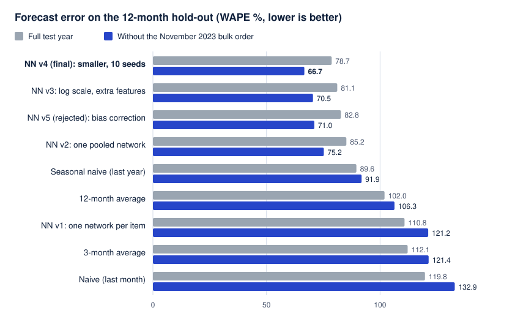

# Sales Forecasting with a Neural Network

A scikit-learn neural network that forecasts monthly sales for ten high-volume inventory items, tested against four simple baselines on 12 months of data it never saw during training.

I built it as a quiz project for a graduate course (GRT713). The sales-order history belongs to a company and stays private, so this repository holds the code and the error figures, not the data.

## What this project shows

| What an AI/ML team looks for | Where it shows up here |
|---|---|
| Honest evaluation | Four baselines, a 12-month hold-out the models never saw, and the same four metrics for every model |
| No leakage from the future | Scaling statistics come from the training months only, and every forecast uses past values only |
| Iterating with evidence | Five model versions in the order I tried them. The one that made results worse (v5) stays in the table |
| Reporting limits | The bias, the single hold-out period and the small number of items are stated up front |

## Result



| Model | MAE | RMSE | WAPE % | WAPE % without the bulk-order month |
|---|---:|---:|---:|---:|
| Naive (last month) | 25.16 | 56.58 | 119.75 | 132.86 |
| 3-month moving average | 23.56 | 45.74 | 112.14 | 121.36 |
| 12-month moving average | 21.42 | 41.17 | 101.97 | 106.34 |
| Seasonal naive (same month last year) | 18.82 | 42.38 | 89.57 | 91.87 |
| NN v1: one network per item, raw scale | 23.27 | 43.71 | 110.76 | 121.17 |
| NN v2: one pooled network, per-item scaling | 17.89 | 41.85 | 85.15 | 75.23 |
| NN v3: log transform, seasonality and rolling features | 17.05 | 40.81 | 81.14 | 70.47 |
| **NN v4 (final): smaller network, 10-seed ensemble** | **16.53** | **40.24** | **78.69** | **66.67** |
| NN v5 (rejected): log-normal bias correction | 17.39 | 39.87 | 82.76 | 71.04 |

The test period is October 2023 to September 2024. MAE and RMSE are in units per item per month. WAPE is the total absolute error divided by total actual sales, so lower is better. It is high for every model because monthly demand for a single item is lumpy, so the gap between models matters more than the level. All figures are in [metrics_overall.csv](metrics_overall.csv).

What the table supports:

- The final model (v4) beats all four baselines on MAE, RMSE and WAPE. Its MAE and WAPE are about 12% lower than the best baseline, the seasonal naive forecast.
- One bulk order in November 2023 (about seven times a normal month) is real demand, so it stays in the data, but no model could predict it. Without that month the final model's WAPE is 66.7% against 91.9% for the best baseline, about 27% lower.
- Against the best baseline, the final model has the lower WAPE on 6 of the 10 items over the full test year, and on 8 of 10 without the bulk-order month.
- I tried a log-normal bias correction (v5). It reduced the under-forecast on the full year but raised MAE and WAPE, and it over-forecast by 38% without the bulk-order month, so I rejected it.

## Limits

- **It under-forecasts total volume.** The final model's bias is -37% over the full test year. Without the bulk-order month it is -1.5%, so almost all of the gap comes from that one order.
- **One hold-out period and ten items.** The ranking of models comes from a single 12-month test, so read it as a hint, not proof. Several test windows (rolling-origin evaluation) would be a stronger test.
- **Models v1 to v3 use one random seed, v4 and v5 average ten.** So v4's gain over v3 mixes a smaller network with the ensemble.
- **The six-month forecast is recursive.** Each prediction is fed back in as the next month's input, so errors can compound. I could not check it against real data.

## How it works

1. **Load and clean.** Reads the order lines from Excel, trims text fields and drops the incomplete last month, zero-quantity lines and re-issued duplicate lines. Cleaning removed 117 of 49,272 rows: 8 partial-month, 1 zero-quantity and 108 re-issued duplicates.
2. **Monthly series.** Sums the quantity per item per month for ten items that had orders in every month.
3. **Features.** Twelve monthly lags, rolling means over 3, 6 and 12 months, the rolling standard deviation, the month of the year (sine and cosine) and which item it is. Each item is scaled with training-month statistics only (log1p, then z-score).
4. **Models.** scikit-learn's `MLPRegressor` (ReLU, Adam, early stopping). Versions run from one network per item (v1) to one pooled network with log scaling and extra features (v3) and then a smaller network averaged over ten seeds (v4, final).
5. **Evaluation.** One-step-ahead forecasts for the last 12 months, using actual past values as inputs, compared with four baselines on MAE, RMSE, WAPE and bias.
6. **Forecast.** The final model is retrained on all the data and forecasts October 2024 to March 2025.

## Run it

You need your own sales-order Excel file with these columns: `Order Date`, `Item Number`, `Item Description 1`, `Item Description 2`, `Quantity Ordered`, `Salesperson Number`, `Customer Number` and `ord_no`. Edit `ITEMS` at the top of the script to pick the items to forecast.

```bash
pip install -r requirements.txt
python sales_forecast.py path/to/Sales_orders.xlsx
```

Without an argument it looks for a `Sales_orders*.xlsx` file in the script's folder. It writes metrics, predictions, the six-month forecast and charts to an `output` folder next to the script.

I dry-ran it on a synthetic file with the same columns (Python 3.13, pandas 3.0.5, scikit-learn 1.9.1) to check that it runs on current library versions. Those numbers mean nothing, and the results above come from the real data.

## Files

| File | Purpose |
|---|---|
| `sales_forecast.py` | Cleaning, features, five model versions, baselines, metrics, charts and the forecast |
| `requirements.txt` | Python packages to install |
| `metrics_overall.csv` | The error figures behind the table above |
| `model_comparison.svg` | The chart above |

## Author

Made by [Muhammad Huzaifa Shafique](https://github.com/Muhammad-Huzaifa-Shafique).
